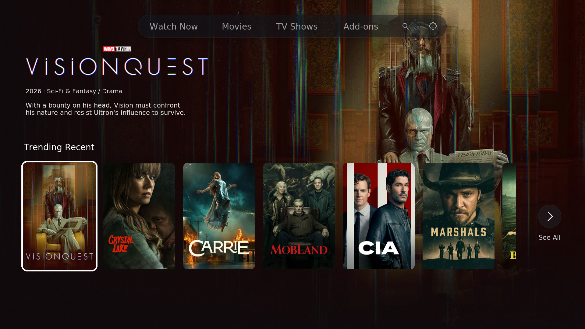
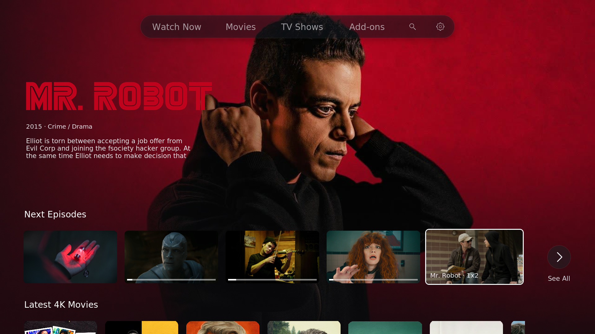
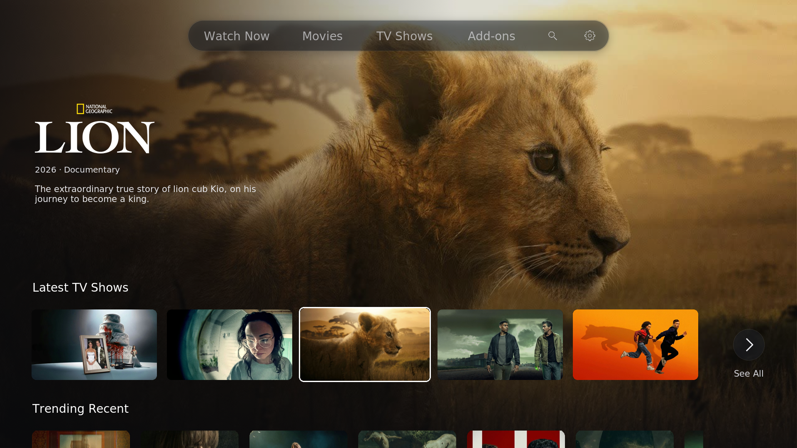
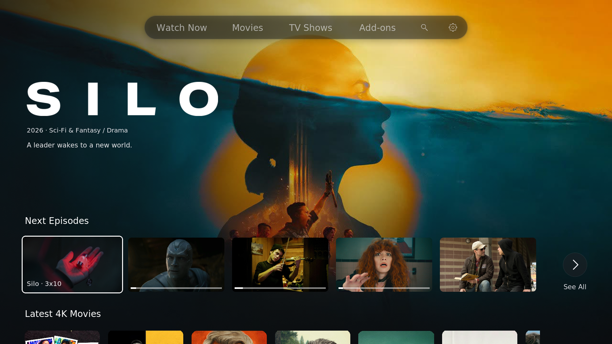

# Pyrus Skin

**An Apple TV-inspired Kodi skin by kamilwhoo.**

Cinematic artwork, configurable widgets, clean playback controls and detailed Player Info.

## What's new in 1.1.1

- Move left/right while focused on the top bar to switch hubs **without pressing OK**.
- Press OK to open the full library or a destination you configure for that hub.
- Three optional custom hubs with eight widget rows each; up to six inline submenu links per hub.
- Native Live TV/Radio destinations: guide, channels, recordings and timers.
- Localizable interface labels, episode titles and ratings supplied by your content add-on.
- Page geometry changes without a full skin reload; hidden tabs cannot capture restored focus.
- Full menu/widget backups, Czech/Slovak label fixes and on-demand repository diagnostics.
- Capability-gated Reboot to Android on CoreELEC.
- Existing Player Process Info (PPI): **Media**, **Decoder / Output**, **System**.

Configure the menu in **Kodi Settings → Skin Settings → Top menu and submenus**.
The Settings gear continues to open Kodi Settings directly. Existing widget settings are retained.

## Install

1. Enable Unknown sources in Kodi Settings → System → Add-ons.
2. File manager → Add source: **https://kamilfotoveci-design.github.io/applify/**
3. Name the source Pyrus.
4. Add-ons → Install from ZIP file → Pyrus → **repository.applify-1.0.2.zip**.
5. Install from repository → **Pyrus Repository → Look and feel → Skin → Pyrus Skin**.

The repository provides updates. The technical IDs `skin.applify` and `repository.applify`
remain unchanged to preserve existing installations.

If the repository cannot connect, restart Kodi once and use **Check for updates**.
One Fire Cube 3 user reported this resolved installation. If it still fails,
report your device, exact Kodi build and a Kodi log captured after the failure.
A permanent root cause for all reported connection failures has not been established.
You can install [the skin ZIP directly](https://kamilfotoveci-design.github.io/applify/skin.applify/skin.applify-1.1.1.zip).

## Compatibility and validation

The maintainer has tested the skin on Kodi 22. The 1.1.1 changes passed offline
regression checks; **device validation of this update is still required**.
Kodi 21/22 builds and hardware can expose different Player Info fields. Missing
HDR, Dolby Vision or decoder details are not proof that a format is unsupported.
PVR requires your own enabled PVR client and backend. The skin does not supply channels.
Ratings depend on the values returned by the selected item's add-on; no API key is bundled.

Pyrus interface catalogs include Czech and Slovak translations. German, French,
Spanish, Italian and Polish include partial translations. Existing language catalogs are retained;
new untranslated text falls back to English. Your custom widget titles are preserved.

See [1.1.1 release notes and device checklist](RELEASE-1.1.1.txt).

## Screenshots

## Credits and integrity

Pyrus Skin is maintained by **kamilwhoo** and builds on work by the **Estuary contributors**.
Original notices, component licenses and font terms remain inside the package.
This repository does not override those terms. SHA-256 checks detect unexpected
changes against a trusted reference; they are not a digital signature or copy protection.

Independent community project. Not affiliated with Apple or Team Kodi.

## Diagnostics and device reports

Skin Settings → Backup / Refresh / Reset → Repository and playback diagnostics.
The report is saved in `userdata/addon_data/skin.applify/diagnostics.json`.
It checks the index and its hashes over normal verified HTTPS and records selected
Kodi output labels. It does not collect account credentials or media URLs.
Use Check for repository updates to request Kodi's native refresh.

TV-led Dolby Vision/zero-L5 black video and complete p3i T4c compatibility remain
unverified device reports. Compare the same file/settings against Estuary and include
fresh logs. This update does not force HDR/DV options. PVR requires a configured backend.
Full arbitrary menu ordering and unlimited tabs are not provided: the current editor
supports three extra hubs and six child links per hub. No separate unpacked source
folder is published; the installable Kodi ZIP necessarily contains readable code.
