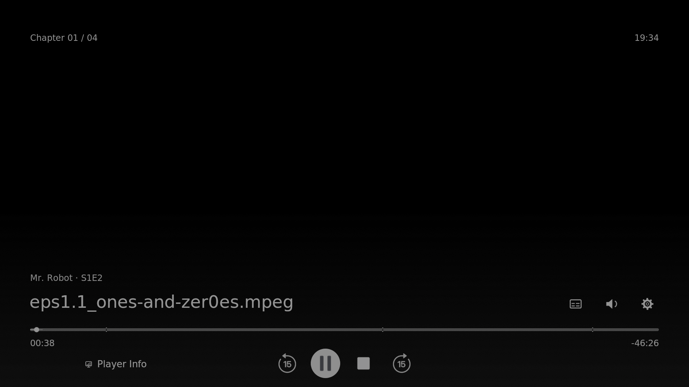

# Pyrus Skin

**An Apple TV-inspired skin for Kodi, by kamilwhoo.**
Cinematic artwork, configurable widgets, clean playback controls and detailed Player Info.

## Screenshots

| Home | Widgets |
| --- | --- |
|  |  |
| **TV Shows** | **Collections** |
|  |  |

## Features

- Configurable widget rows with per-hub widget lists and hero-row selection.
- Up to three custom hubs with eight widget rows each and six submenu links per hub.
- Background and 60-second refresh of the active hub's widgets, no skin reload.
- Left/Right on the top bar switches hubs without pressing OK.
- Watched badges, seek-step and seek-offset feedback.
- Native Live TV / Radio destinations: guide, channels, recordings and timers.
- Player Process Info: **Media**, **Decoder / Output**, **System**.
- Power button with Kodi Power Options; Reboot where the device supports it.
- Menu and widget backups, on-demand repository diagnostics.

See [CHANGELOG.md](CHANGELOG.md) for every version.

## Install

**Recommended: through the Pyrus Repository, so you get automatic updates.**

1. Kodi **Settings → System → Add-ons**: enable *Unknown sources*.
2. **File manager → Add source**: `https://kamilfotoveci-design.github.io/applify/`, name it `Pyrus`.
3. **Add-ons → Install from ZIP file → Pyrus →** `repository.applify-1.0.2.zip`.
4. **Install from repository → Pyrus Repository → Look and feel → Skin → Pyrus Skin**.

**Manual:** download `skin.applify-<version>.zip` from the [latest release](https://github.com/kamilfotoveci-design/applify/releases/latest) and use *Install from ZIP file*. Do not extract the ZIP and do not uninstall your existing skin.

The technical IDs `skin.applify` and `repository.applify` are unchanged to keep existing installations working.

If the repository cannot connect, restart Kodi once and use **Check for updates**. If it still fails, open an issue with your device, exact Kodi build and a Kodi log captured after the failure.

## Compatibility

- Developed and tested on Kodi 22; Kodi 21 is supported. Each new release still needs device confirmation.
- Player Info fields depend on Kodi build and hardware. A missing HDR, Dolby Vision or decoder field does not prove a format is unsupported.
- PVR needs your own PVR client and backend. The skin supplies no channels.
- Ratings and episode titles come from your content add-on. No API key is bundled.
- Only the English skin language catalog is shipped.

## Known limitations

- Arbitrary menu ordering and unlimited tabs are not supported.
- TV-led Dolby Vision black-video reports and some p3i compatibility cases are unverified. Compare the same file against Estuary and include fresh logs when reporting.

## Diagnostics

**Skin Settings → Backup / Refresh / Reset → Repository and playback diagnostics.**
The report is written to `userdata/addon_data/skin.applify/diagnostics.json`. It checks the repository index and hashes over verified HTTPS and records selected Kodi output labels. It collects no credentials or media URLs.

## Repository layout

| Path | Contents |
| --- | --- |
| `skin.applify-<version>.zip` | Installable skin (latest only; older versions are on the [Releases](https://github.com/kamilfotoveci-design/applify/releases) page) |
| `source/` | Readable skin source mirrored from the ZIP: XML, Python, manifests |
| `build_repository.py` | Builds the Kodi repository published to GitHub Pages |
| `docs/archive/` | Historical release notes |

## Credits and licence

Maintained by **kamilwhoo**. Builds on work by the **Estuary contributors** (Team Kodi). Original notices, component licences and font terms stay inside the package (`NOTICE.txt`, `LICENSE`) and this repository does not override them.

SHA-256 checks detect unexpected changes against a trusted reference; they are not a digital signature.

Independent community project. Not affiliated with Apple or Team Kodi.